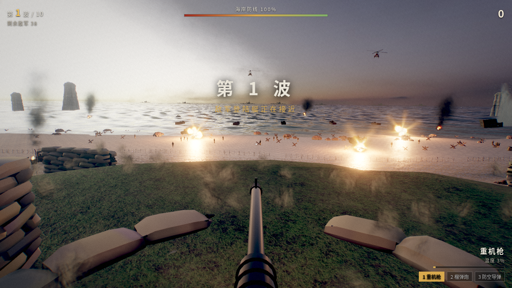
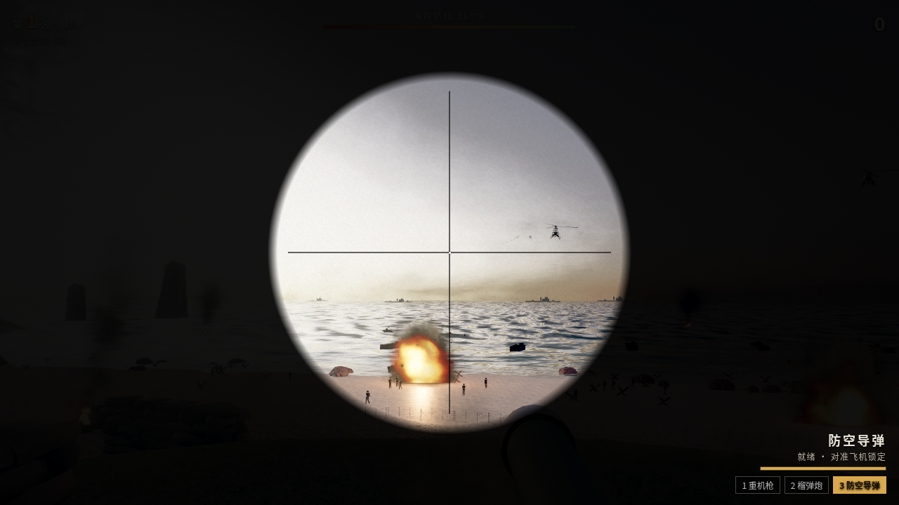
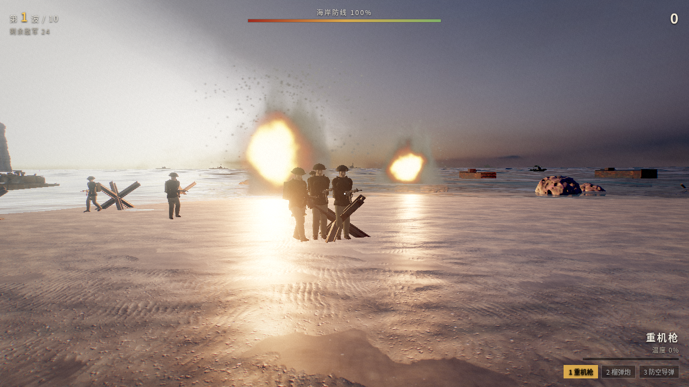

# 抢滩登陆 · 黎明防线

Realistic WebGL beach-defense shooter (three.js). Play: https://wzg815.github.io/beach-assault/

Hold the dune-top emplacement against 10 escalating landing waves with a heavy machine gun, a howitzer and AA missiles.
Desktop: mouse aim, left click fire, 1/2/3 weapons, right click zoom. Mobile (landscape): drag right half to aim, on-screen fire/weapon/zoom buttons.
Settings include 画质 and 血腥效果 (on by default). Assets are CC0, see CREDITS.md. Source in `source/`.
